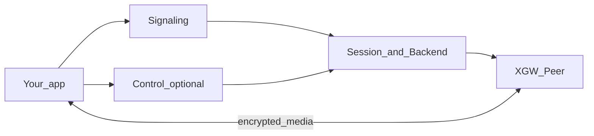
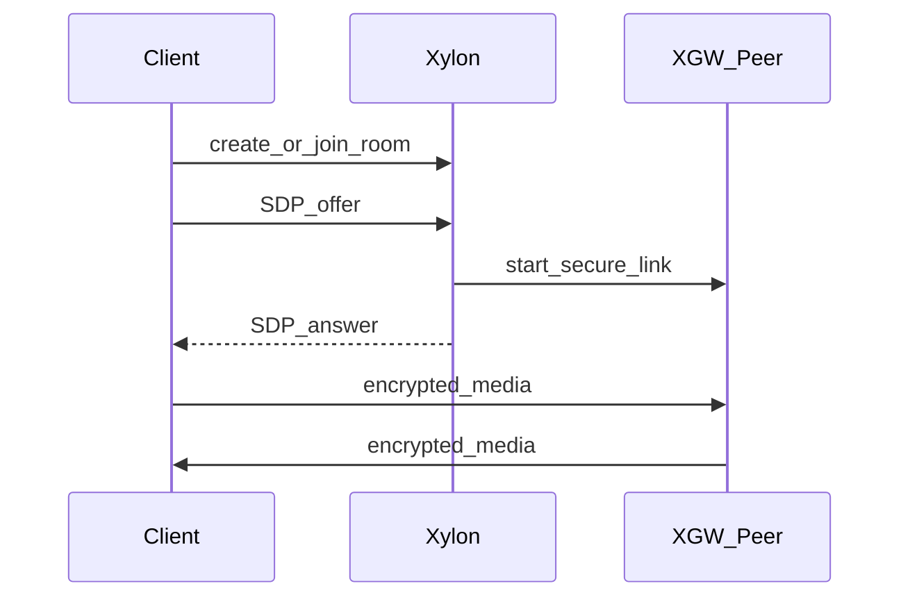
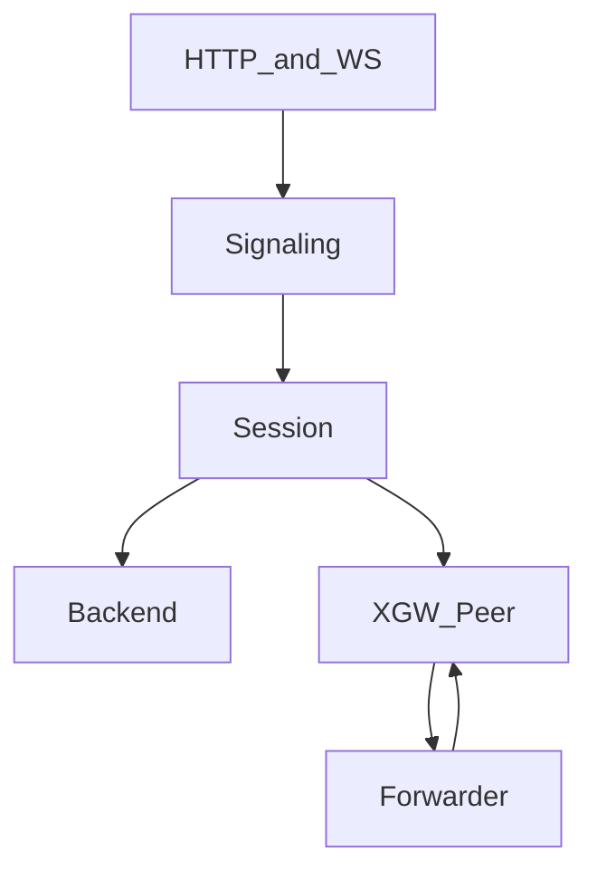

# Xylon architecture

This document explains **how Xylon works today** for readers who are new to
real-time media servers. It stays with plain language first, then names the
modules you will see in the code.

Run labs and curl examples: [README.md](README.md).

---

## What problem Xylon solves

People on the internet want to hear and see each other live -- meetings, classes,
games voice, support calls. Browsers and phones can capture a microphone and
camera, but they need a **server in the middle** that can:

1. **Agree how to connect** (addresses, codecs, encryption).
2. **Carry encrypted media** safely across the network.
3. **Decide what to do with the media** once it is decrypted on the server
   (echo it back, forward it to other people in a room, fan out chat, and so on).

Xylon is that middle layer. It does **not** replace your product UI, your user
login system, or a global CDN. It runs rooms (sessions), talks signaling with
clients, and plugs in a **media policy** (a Backend) for each room.

On the wire, browsers still speak WebRTC. Xylon uses sibling libraries for the
hard transport and SDP work:

| Library | Job |
| --- | --- |
| [XGW](https://github.com/Lazarus404/xgw) | ICE, DTLS, SRTP, SCTP -- the encrypted path to each client |
| [xsdp](https://github.com/Lazarus404/xsdp) | Offer/answer SDP negotiation |
| [xmedialib](https://github.com/Lazarus404/xmedialib) | RTP/RTCP and codec helpers |
| [xsip](https://github.com/Lazarus404/xsip) | Optional SIP for softphone labs |

Optional **Control** features (auth tokens, mute/kick, who-is-in-the-room lists,
server-sent chat inject) live inside this app as `Xylon.Control` and are **off**
until you turn them on.

---

## The big picture

Think of three layers:

```text
  Your app (browser, SIP phone, or backend tool)
           |
           |  signaling (HTTP or WebSocket) + optional Control REST
           v
  +------------------+
  |      Xylon       |  rooms, rules, who may join, mute/kick, inject
  |  Session +       |
  |  Backend policy  |
  +--------+---------+
           |
           |  encrypted media
           v
  +------------------+
  |   XGW Peer       |  one secure link per participant
  +------------------+
```

- **Signaling** is the small control conversation: "create this room", "here is
  my offer SDP", "here is an ICE candidate".
- **Media** is the continuous audio/video/data after the connection is up. That
  traffic goes client <-> XGW Peer. Xylon's Backend only sees **decrypted**
  packets after XGW unwraps them.
- **Control** (optional) is for operators and host backends: inject a message,
  mute or kick someone, list who is present, read recent chat history.



---

## Words you will keep seeing

| Word | Everyday meaning |
| --- | --- |
| **Tenant** | Which customer or environment owns the room (`tenant_id`) |
| **Session** | One room or call (`session_id`). One Backend policy for the whole room |
| **Participant** | One person (or bot) in that room, with one secure Peer link |
| **Backend** | The room's media rules: echo, conference SFU, datachannel fanout, ... |
| **SDP offer/answer** | The written agreement of codecs and connection details |
| **ICE** | Finding a working network path between client and server |
| **Catalogue** | The list of Backend modules you attached at boot (`:echo`, `:conference`, ...) |

---

## A room, step by step

1. Your host (or lab) starts Xylon with at least one Backend attached and an ICE
   advertise address the browser can reach.
2. A client **creates or joins** a session for `{tenant_id, session_id}`.
3. The client sends an **SDP offer**. Xylon builds an **answer**, starts an XGW
   Peer for that participant, and returns the answer.
4. Browser and Peer finish ICE/DTLS. Media flows.
5. The Backend decides what happens to plaintext RTP/data (echo, forward to
   subscribers, publish chat, and so on).
6. When the last participant leaves, the Session can exit.



---

## What a Backend is

A Backend is a small policy module for **one** Session. It answers questions like:

- When someone joins or leaves, what happens?
- When audio/video packets arrive, where do they go?
- When a datachannel message arrives, who should receive a copy?

Xylon core ships **Echo** for labs. Other policies are separate packages you
attach at boot:

| Catalogue id | Package | What it does today |
| --- | --- | --- |
| `:echo` | in-tree `Xylon.Backend.Echo` | Sends your media back to you (loopback lab) |
| `:conference` | [xylon-conference-backend](https://github.com/Lazarus404/xylon-conference-backend) | Multiparty room SFU: publish, subscribe by mid, mute by mid, feeds, talking signals, simulcast layer select. Broadcast/webinar is the same Backend with publisher vs spectator caps (`require_publish_cap` + `"publish"`), not a separate stack. |
| `:datachannel` | [xylon-datachannel-backend](https://github.com/Lazarus404/xylon_datachannel_backend) | Reliable datachannel fanout / labeled chat |

Rules that stay true today:

- **One Backend module per Session** (no stacking two Backends in one room).
- Backends never hold DTLS/SRTP keys; they only see plaintext after XGW.
- Attach at boot: `config :xylon, backends: [...]` and `default_backend: :echo`
  (or another attached id).

Conference rooms commonly use:

- `subscribe_mode: :mesh` -- server auto-subscribes everyone (handy for labs).
- `subscribe_mode: :manual` -- app chooses who receives whom via subscribe APIs
  after **feeds** say who is publishing.

---

## How clients talk to Xylon

All three signaling paths end in the same place: create/join a Session, apply an
offer, optionally leave. They differ in transport and features.

### 1. HTTP (scripts, servers, lab tools)

Good for curl and backends that already speak HTTP.

- Create: `POST /v1/sessions`
- Offer: `POST /v1/sessions/:id/offer` (body = offer SDP, response = answer SDP)
- Leave: `DELETE /v1/sessions/:id/participants/:participant_id`
- Subscribe / unpublish / switch / update: JSON POSTs on the same HTTP plug when
  the Backend supports them

ICE candidates usually travel **inside** the offer SDP on this path (no separate
HTTP trickle API).

### 2. Control WebSocket (browsers)

Requires Control enabled (`GET /v1/ws`).

Typical frames: `join` -> `offer` / `answer` -> `ice` / `ice_ok`, plus subscribe
frames and server pushes for presence and feeds. This path supports post-offer
ICE trickle and, when ICE mode is full, outbound server candidates.

Under HMAC/JWT auth, the token's `participant_id` is your identity. A mismatched
client-supplied id is rejected (require_pvtid-style bind).

### 3. SIP over WebSocket (Echo softphone lab)

`GET /sip` with subprotocol `sip`. Intended for SIP.js against Echo. Tenant is
fixed to `lab`. Not the multi-tenant Control product surface.

### Which one to pick

| You want | Prefer |
| --- | --- |
| Curl / automated tests / Control REST | HTTP |
| Browser with trickle ICE + presence/feeds | Control WebSocket (+ HTTP for REST ops) |
| SIP.js against Echo | SIP WebSocket |

---

## Optional Control plane

Turn on with `config :xylon, control: [enabled: true, ...]`.

Control is for **operators and host services**, not a second media path.

| Capability | Everyday meaning |
| --- | --- |
| Auth | Lab header trust, or HMAC/JWT bearer tokens minted by your backend |
| Inject | Server sends a datachannel payload into a room (`POST .../data`) |
| Moderate | Mute/unmute (and pause conference outbound A/V by mid), ban/unban, kick (+ optional ban) |
| Presence | Who joined/left the room |
| Feeds | Who is actively publishing audio/video (separate from join/leave) |
| Quota | Caps on joins, participants, inject rate |
| History | Short in-memory ring of labeled messages |
| Webhooks | Async notices to your URL (joined, left, inject, quota, session ended) |
| gRPC | Optional Inject / Presence / History Get when `grpc_port` is set |

Mute vs unpublish vs leave vs kick (conference):

| Action | Effect |
| --- | --- |
| Mute | Pause forwarding; person stays; feed still shows published |
| Unpublish | Tear down selected streams; person can stay in the room |
| Leave | Person leaves; their feed is cleared |
| Kick | Force leave (feeds unpublished); optional ban in the same request |

When Control is off, Control HTTP routes and `GET /v1/ws` return 404. Plain HTTP
create/offer still work with `x-tenant-id` in lab mode.

---

## Inside the process (OTP)

At start, Xylon:

1. Builds a **catalogue** of attached Backend modules.
2. Starts a Registry and Session supervisor.
3. Optionally starts Control GenServers and a Bandit HTTP listener.

Each Session is a GenServer keyed by `{tenant_id, session_id}`. Participants each
own an XGW Peer. A **Forwarder** sits on the Peer hot path so Session is not
flooded with every RTP packet: plans in ETS say where plaintext packets go.

Session and Forwarder each call `Backend.init/2` and keep separate opaque
`backend_state` maps. Control callbacks update the Session copy; RTP/RTCP/DC
ingress updates the Forwarder copy. Mutable fields both must see belong in a
backend-owned store keyed by the Session pid (for example Plan or Runtime ETS
in a catalogue package), not only in those maps. See `Xylon.Backend`.



---

## Connecting over the network (ICE today)

Browsers must learn a server address they can reach. Xylon requires ICE config
with an advertised IP (or list):

```elixir
config :xylon,
  ice: [
    advertised_ip: {127, 0, 0, 1}
    # mode: :lite   # default -- host candidates in the answer
    # mode: :full   # Control WS can trickle server candidates too
  ]
```

Labs often set `XYLON_ADVERTISED_IP=127.0.0.1`. Prefer one address clients
actually use; advertising every NIC can confuse browser path selection.

---

## Configuration sketch

```elixir
config :xylon,
  backends: [Xylon.Backend.Echo],
  default_backend: :echo,
  http_port: 8080,
  ice: [advertised_ip: {127, 0, 0, 1}],
  control: [
    enabled: false,
    auth: :lab,          # :lab | :hmac | :jwt
    hmac_secret: nil,
    quotas: %{
      max_participants: 50,
      inject_per_minute: 120,
      join_per_minute: 60
    }
  ]
```

Attach conference or datachannel by depending on those packages and listing their
Backend modules in `:backends`. See each package README for room opts.

---

## What this app is not

- Not your IdP / password store (your backend mints tokens when using HMAC/JWT).
- Not a recording product by itself (recording is a separate tap/library concern).
- Not a global multi-region PoP network.
- Not a second WebRTC stack -- XGW terminates the wire protocol.

Browser helper for Control WS:
[xylon-client-sdk](https://github.com/Lazarus404/xylon-client-sdk).

---

## Related reading

- [README.md](README.md) -- run Echo / Control curls / Mix tasks
- [XGW](https://github.com/Lazarus404/xgw) -- Peer and Listener transport
- [xylon-conference-backend](https://github.com/Lazarus404/xylon-conference-backend) -- room SFU
- [xylon-datachannel-backend](https://github.com/Lazarus404/xylon_datachannel_backend) -- datachannel fanout
- [xylon-client-sdk](https://github.com/Lazarus404/xylon-client-sdk) -- browser Control WS client
